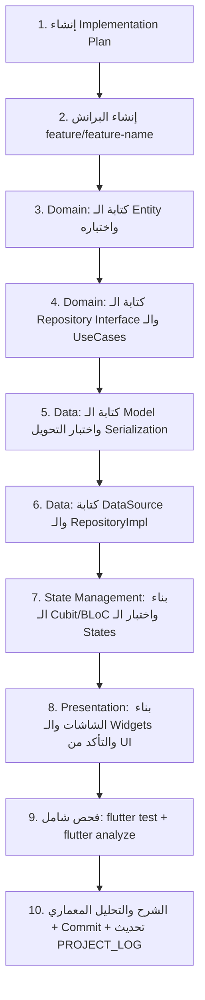

# 🏛️ Master Engineering Framework & Agent Workflow
### Comprehensive Guidelines for Scalable Flutter & Clean Architecture Development

---

## 📌 1. الفلسفة العامة والمبادئ الأساسية (Core Principles)

هذا الدليل يمثل المرجعية القياسية (Standard Operating Procedure) لإدارة وبناء أي تطبيق Flutter بالتعاون بين المطور والـ AI Agent، من أول سطر كود حتى الإطلاق. تم تصميمه ليكون **عاماً وقابلاً لإعادة الاستخدام في أي مشروع جديد**.

### المبادئ الخمسة الحاكمة (The 5 Golden Rules):

1. **العمل التدريجي غير المجمّع (Strict Incremental Execution):**
   - يُمنع منعاً باتاً كتابة ميزات كبيرة أو أكواد متعددة الطبقات دفعة واحدة (No Code Dumps).
   - يتم تقسيم كل ميزة إلى مهام صغيرة جداً (Bite-Sized Sub-Tasks)، حيث تستغرق المهمة الواحدة من 5 إلى 15 دقيقة فقط من العمل المركز.
   - التسلسل الإلزامي دائماً: **Domain ➡️ Data ➡️ State Management ➡️ Presentation**.

2. **التحقق والاختبار أولاً (Verification & TDD First):**
   - لكل خطوة اختبار: كتابة الـ Unit / Widget Test أولاً والتأكد من فشله المتوقع (Red Phase)، ثم كتابة الكود ليجتاز الاختبار (Green Phase).
   - لا يُعتبر أي كود مكتملاً إلا بعد تشغيل أمرين بنجاح تام:
     1. `flutter test` (أو `dart test`) ⬅️ نسبة نجاح 100%.
     2. `flutter analyze` ⬅️ النتيجة: `No issues found!` (صفر أخطاء، صفر تحذيرات).

3. **الشرح والتحليل المعماري الإلزامي بعد كل مرحلة (Comprehensive Technical Walkthrough):**
   - بعد الانتهاء من كل مهمة واجتياز اختباراتها، يلتزم الـ Agent بتقديم تقرير تقني مفصل يشرح:
     - **"لماذا" قبل "كيف" (The "Why" before the "How"):** سبب اختيار النمط المعماري أو طريقة كتابة الكود.
     - **تشريح الكود سطر بسطر:** شرح المكونات، المدخلات، المخرجات، ودواعي استخدام المتغيرات والدوال.
     - **مبادئ التصميم (Design Patterns & SOLID):** توضيح كيفية تطبيق المبادئ (مثل Dependency Inversion، Single Responsibility، Immutability).
     - **معالجة الحالات الخاصة (Edge Cases & Tradeoffs):** الأخطاء المحتملة وكيف تم تفاديها.

4. **فصل المسؤوليات ونقاء البنية (Clean Architecture Integrity):**
   - طبقة الـ `domain` مستقلة تماماً (Pure Dart) بدون أي ارتباط بـ Flutter Widgets أو مكاتب خارجية كـ Firebase.
   - طبقة الـ `data` هي المسؤولة الوحيدة عن التحويل (Serialization) والتواصل مع الـ APIs أو قواعد البيانات.
   - طبقة الـ `presentation` مسؤولة فقط عن عرض البيانات والتقاط تفاعلات المستخدم.

5. **انضباط Git والـ Commits الذرية (Atomic Semantic Commits):**
   - كل مهمة فرعية (Sub-Task) تنتهي وتُختبر بنجاح يتم عمل Commit منفصل وفوري لها.
   - استخدام التسميات القياسية:
     - `feat:` لميزة جديدة.
     - `test:` لكتابة أو تعديل اختبارات.
     - `fix:` لإصلاح خطأ.
     - `refactor:` لإعادة هيكلة كود دون تغيير وظيفته.
     - `docs:` لتوثيق وتحديث سجلات المشروع.

---

## 📁 2. نظام التوثيق الإلزامي للمشروع (Documentation System)

في أي مشروع تبدأه، يجب إنشاء الملفات التالية في الجذر (Root Directory)، مع إضافتها لملف `.gitignore` إن كانت خاصة بتوجيه الـ Agent محلياً:

```
project_root/
├── AGENTS.md               # دستور وقواعد عمل الـ Agent في هذا المشروع
├── PROJECT.md              # مواصفات المشروع، المتطلبات، ومخطط قاعدة البيانات
├── PROJECT_LOG.md          # سجل الإنجاز وتتبع المراحل خطوة بخطوة
├── ENGINEERING_FRAMEWORK.md# هذا الملف (المرجع الشامل لطريقة العمل)
├── HANDOFF.md              # وثيقة تسليم واستئناف الشغل بين الجلسات
└── docs/
    └── plans/              # خطط التنفيذ التفصيلية لكل Feature
        └── YYYY-MM-DD-<feature-name>.md
```

### وظيفة ومحتوى كل ملف:

#### 1. `AGENTS.md` (دستور الـ Agent):
- يحدد دور الـ Agent، القواعد الصارمة، لغة التواصل، ونظام العمل المتفق عليه.
- يقرأه الـ Agent في بداية كل جلسة ليتصرف وفق القواعد المحددة دون انحراف.

#### 2. `PROJECT.md` (وثيقة مواصفات المشروع):
- يحتوي على:
  - اسم التطبيق والهدف منه.
  - الفئات المستهدفة وأدوار المستخدمين (User Roles).
  - تفصيل الموديولات والميزات (Features Breakdown).
  - مخطط قاعدة البيانات (Firestore Collections / SQL Tables Schemas).
  - قائمة الحزم والتقنيات المعتمدة (Tech Stack).

#### 3. `PROJECT_LOG.md` (سجل تتبع المشروع الحقيقي):
- جدول مراحل العمل وحالتها:
  - `Phase | Description | Status (Pending/In Progress/Completed) | Verification Method | Commit Hash`
- سجل تاريخي (Changelog) يسجل التاريخ، ما تم إنجازه بدقة، والخطوة التالية مباشرة.

#### 4. `docs/plans/YYYY-MM-DD-<feature>.md` (خطة تنفيذ الميزة):
- قبل لمس أي كود لميزة جديدة، يكتب الـ Agent خطة تنفيذية كاملة بصيغة TDD:
  - الهدف والقيود المعمارية.
  - قائمة الملفات التي سيتم إنشاؤها وتعديلها.
  - الخطوات التفصيلية (Step 1: Write failing test -> Step 2: Implement -> Step 3: Verify -> Step 4: Explain -> Step 5: Commit).

#### 5. `HANDOFF.md` (وثيقة التسليم والاستئناف):
- عند التوقف عن العمل أو الانتقال لجهاز/جلسة أخرى، يُكتب في هذا الملف ملخص دقيق لما تم، أين توقفنا، والخطوة القادمة فور فتح المشروع.

---

## 🏗️ 3. الهيكلية المعمارية القياسية (Clean Architecture Directory Tree)

تعتمد البنية على تقسيم المشروع حسب الميزات (Feature-First Clean Architecture):

```
lib/
├── core/                                   # المكونات المشتركة لجميع أجزاء التطبيق
│   ├── config/                             # إعدادات التطبيق والبيئات (Dev, Prod)
│   ├── constants/                          # الثوابت (ألوان، نصوص، روابط)
│   ├── errors/                             # أصناف الأخطاء والـ Failures الموحدة
│   ├── exceptions/                         # استثناءات السيرفر وقاعدة البيانات
│   ├── network/                            # الـ HTTP Client أو فحص الاتصال
│   ├── services/                           # الخدمات العامة (Storage, Location, etc.)
│   ├── theme/                              # الثيمات، الخطوط، وأحجام الشاشات
│   ├── utils/                              # الدوال المساعدة (تاريخ، توليد أكواد، تنسيق)
│   └── widgets/                            # الودجات المشتركة (Buttons, Inputs, Dialogs)
│
└── features/                               # مجلد الميزات (كل ميزة موديول مستقل)
    └── [feature_name]/                     # مثال: auth, classes, attendance, profile
        ├── domain/                         # طبقة منطق الأعمال (Pure Dart - الصفر تبعيات)
        │   ├── entities/                   # كائنات الأعمال الأساسية (مثل: UserEntity, ClassEntity)
        │   ├── repositories/               # العقود والتجريدات (Abstract Interfaces)
        │   └── usecases/                   # حالات الاستخدام الفردية (Single Responsibility)
        │
        ├── data/                           # طبقة جلب وتخزين البيانات
        │   ├── models/                     # نماذج البيانات مع الـ Serialization (JSON/Firestore)
        │   ├── datasources/                # مصادر البيانات (Remote API/Firestore & Local Cache)
        │   └── repositories/               # التنفيذ الفعلي للعقود (Repository Implementation)
        │
        └── presentation/                   # طبقة واجهة المستخدم وإدارة الحالة
            ├── bloc/                       # أو cubit (State, Event, Cubit/Bloc)
            ├── pages/                      # الشاشات الرئيسية للميزة (Screens/Views)
            └── widgets/                    # الودجات الخاصة بهذه الميزة فقط
```

---

## 🔄 4. دورة حياة بناء أي ميزة من الصفر (Step-by-Step Feature Lifecycle)

عند البدء في ميزة جديدة، يتم اتباع هذا التسلسل الحرفي:



### تفاصيل كل مرحلة برمجياً:

### المرحلة 1: الـ Domain Layer (نواة الأعمال)
1. **الـ Entity:**
   - فئة غير قابلة للتعديل (Immutable Class).
   - تحتوي على الحقول الأساسية فقط بدون أي دوال `fromJson` أو ارتباط بقاعدة البيانات.
   - تحتوي على `copyWith` و `operator ==` و `hashCode` لضمان صحة المقارنات بالقيم (Value Equality).
   - استخدام الـ Getters المحسوبة بدلاً من الحقول التكرارية لضمان مصدر وحيد للحقيقة (Single Source of Truth).
2. **الـ Repository Contract:**
   - `abstract class` يحدد الدوال التي يحتاجها التطبيق فقط (`Future<Result>` أو `Stream<Data>`).
   - تعتمد المدخلات والمخرجات على الـ Entities فقط.
3. **الـ UseCases:**
   - كل ملف يمثل عملية واحدة فقط (مثل: `CreateClassUseCase`, `GetUserProfileUseCase`).
   - تحتوي عادة على دالة وحيدة باسم `call()` وتعتمد على الـ Repository عبر الـ Constructor (Dependency Injection).

---

### المرحلة 2: الـ Data Layer (تكامل البيانات)
1. **الـ Model:**
   - يرث مباشرة من الـ Entity: `class ClassModel extends ClassEntity`.
   - يحتوي على دوال التحويل:
     - `fromMap(Map<String, dynamic> map, String id)`
     - `toMap()`
     - `toEntity()` / `fromEntity(ClassEntity entity)`
   - يتعامل بأمان تام مع تحويل الأنواع، مثل تحويل `Timestamp` من Firestore إلى `DateTime` وقيم `null` الافتراضية.
2. **الـ DataSource:**
   - عقد مجرد (`abstract class RemoteDataSource`) يحدد عمليات السيرفر المباشرة.
   - التنفيذ الفعلي (`RemoteDataSourceImpl`) يتعامل مباشرة مع Firestore أو الـ HTTP Client.
3. **الـ Repository Implementation:**
   - ينفذ الـ `ClassRepository` المعرف في الـ Domain.
   - يستدعي الـ DataSource، ويحول النتائج من Models إلى Entities، ويتعامل مع الأخطاء (Exceptions ➡️ Failures).

---

### المرحلة 3: الـ State Management (إدارة الحالة)
1. **الحالات (States):**
   - حالات واضحة ومغلقة (Sealed Classes أو Equatable States):
     - `Initial`
     - `Loading`
     - `Success / Loaded`
     - `Error (مع رسالة خطأ واضحة للمستخدم)`
2. **الـ Cubit / BLoC:**
   - يستقبل الـ UseCases عبر الـ Constructor.
   - يستدعي الـ UseCase ويقوم بعمل `emit()` للحالة المناسبة بناءً على النتيجة.

---

### المرحلة 4: الـ Presentation Layer (واجهات المستخدم)
1. **الشاشات (Pages):**
   - تستهلك الـ Cubit باستخدام `BlocBuilder` أو `BlocConsumer`.
   - معالجة حالات التحميل (`LoadingIndicator`) والأخطاء (`SnackBar` أو `ErrorWidget`) وحالة النجاح.
2. **الودجات الموديلية (Modular Widgets):**
   - تقسيم الصفحة إلى ودجات صغيرة داخل مجلد `presentation/widgets/`.
   - كل ودجة مسؤولة عن عنصر واحد (مثل: كارت المادة، نافذة إدخال الكود، زر الإجراء).

---

## 🛠️ 5. معايير الـ Git وإدارة الفروع (Git Discipline)

1. **تسمية الفروع (Branches):**
   - الفرع الرئيسي: `main`.
   - فروع الميزات: `feature/classes-management` أو `feature/user-auth`.
   - فروع الإصلاحات: `bugfix/fix-login-error`.
2. **الـ Commit بعد كل خطوة:**
   - يُمنع تجميع عدة مهام في Commit واحد.
   - مثال على صيغة الـ Commit:
     ```bash
     git add lib/features/classes/domain/ test/features/classes/
     git commit -m "feat(classes): implement ClassEntity and ClassRepository interface"
     ```
3. **الملفات المحمية محلياً (`.gitignore`):**
   - الملفات التوجيهية وسجلات العمل الخاصة بالـ Agent تضاف لـ `.gitignore` حتى لا تشوش على الفريق أو الريبو العام:
     ```gitignore
     # Local Agent Instructions & Project Logs
     AGENTS.md
     PROJECT.md
     PROJECT_LOG.md
     HANDOFF.md
     ENGINEERING_FRAMEWORK.md
     docs/
     ```

---

## 💡 6. كيف تبدأ مشروعك الجديد بالكامل من الصفر بهذا النظام؟

إذا بدأت تطبيقاً جديداً من الصفر، قم بالخطوات التالية بالترتيب:

### الخطوة 1: تجهيز مستندات النظام
1. أنشئ مشروع فلاتر: `flutter create my_new_app`.
2. انسخ ملف `ENGINEERING_FRAMEWORK.md` إلى جذر المشروع.
3. أنشئ ملف `PROJECT.md` واكتب فيه وصف تطبيقك الجديد، الشاشات، ونموذج البيانات.
4. أنشئ ملف `AGENTS.md` معتمداً على القواعد المذكورة هنا.
5. أنشئ ملف `PROJECT_LOG.md` وضع فيه جدول المراحل الفارغ.
6. أضف أسماء هذه الملفات في `.gitignore`.

### الخطوة 2: توجيه الـ Agent للبدء
أرسل للـ Agent الرسالة التالية في أول محادثة:
> *"يا معلم، اقرأ ملفات `ENGINEERING_FRAMEWORK.md` و `AGENTS.md` و `PROJECT.md`، والتزم بنظام العمل خطوة بخطوة، واكتب خطة التنفيذ للميزة الأولى في `docs/plans/`، وابدأ بمرحلة الـ Domain مع الاختبار والشرح والـ Commit بعد كل خطوة."*

بهذا التوجيه، سيعمل الـ Agent بأعلى دقة واحترافية ممكنة كمهندس برمجيات محترف دون تسرع أو أخطاء.
