<p align="center">
  
</p>

<h1 align="center">🎉 Evently — Modern Event Planning & Management App</h1>

<p align="center">
  <strong>A modern, high-performance Flutter mobile application for planning, managing, and discovering events.</strong><br>
  <em>Engineered strictly with Feature-First Clean Architecture, pure Provider state management, dynamic dual theming, and comprehensive English/Arabic localization.</em>
</p>

<p align="center">
  <a href="https://flutter.dev"></a>
  <a href="https://dart.dev"></a>
  <a href="https://pub.dev/packages/provider"></a>
  <a href="https://www.figma.com"></a>
  
  
  
  
</p>

---

## 📑 Table of Contents
- [✨ Project Overview](#-project-overview)
- [📱 Visual App Showcase](#-visual-app-showcase)
  - [1. Authentication & Onboarding Flow](#1-authentication--onboarding-flow)
  - [2. Home Dashboard & Adaptive Dual Theming](#2-home-dashboard--adaptive-dual-theming)
  - [3. Event Creation & Details Lifecycle](#3-event-creation--details-lifecycle)
  - [4. Discovery, Map, Favorites & Profile](#4-discovery-map-favorites--profile)
- [🌟 Key Features & Capabilities](#-key-features--capabilities)
- [🏗️ Architecture & Engineering Blueprint](#️-architecture--engineering-blueprint)
  - [Project Folder Structure](#project-folder-structure)
  - [The 5 Standard Utility Modules (`lib/utils/`)](#the-5-standard-utility-modules-libutils)
  - [State & Data Flow Diagram](#state--data-flow-diagram)
- [🎨 Design System & Tokens](#-design-system--tokens)
- [🧪 Quality Assurance & Test Suites](#-quality-assurance--test-suites)
- [📦 Tech Stack & Dependencies](#-tech-stack--dependencies)
- [🚀 Quickstart & Installation](#-quickstart--installation)
- [👥 Course & License](#-course--license)

---

## ✨ Project Overview

**Evently** is a cross-platform mobile application developed as part of the **Mobile Programming II (NCT)** curriculum. The project demonstrates senior-level Flutter craftsmanship by translating the official [Figma Event Planning App Design](https://www.figma.com/design/uFT7VwlqWrlVin02qATxZ4/Event-Planning-App--Copy-?node-id=0-1) into production-ready code with **100% pixel fidelity**.

The application enables users to:
- Authenticate and manage persistent user sessions (Standard Auth & simulated Google Sign-In).
- Organize and categorize events (**Meetings, Birthdays, Book Clubs, Exhibitions, Sports**).
- Explore events via an interactive **Map Tab** featuring a bottom horizontal event carousel and GPS pin.
- Bookmark favorite events with real-time title search and filtering.
- Switch seamlessly between **Light Theme** (`#F2FEFF`) and **Midnight Dark Theme** (`#101127`).
- Experience full dual localization with automatic layout direction reflow between **English (LTR)** and **Arabic (RTL)**.

---

## 📱 Visual App Showcase

The screenshots below are captured directly from live Android execution, displaying the exact UI across themes, languages, and features:

### 1. Authentication & Onboarding Flow
<div align="center">
  <table>
    <tr>
      <td align="center" width="33%">
        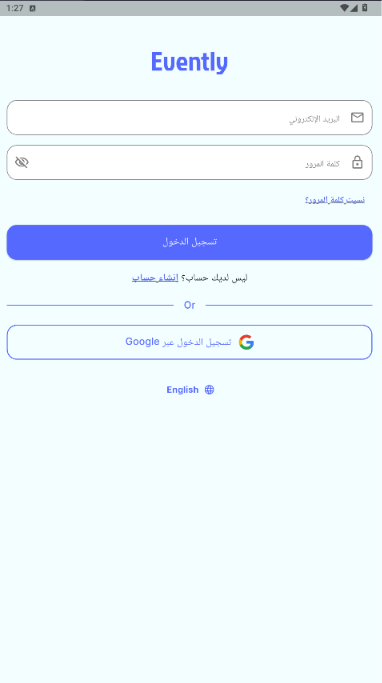<br>
        <strong>Login Screen (Arabic RTL)</strong><br>
        <em>Validated credentials, password toggle, and language selector</em>
      </td>
      <td align="center" width="33%">
        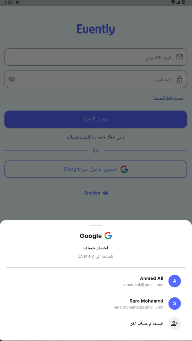<br>
        <strong>Google Sign-In Modal Sheet</strong><br>
        <em>Native-feel account chooser with persistent session sync</em>
      </td>
      <td align="center" width="33%">
        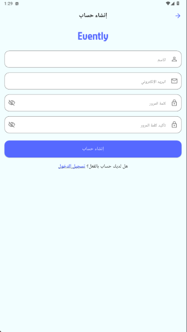<br>
        <strong>Register Screen</strong><br>
        <em>Full validation for name, email, and password confirmation</em>
      </td>
    </tr>
  </table>
</div>

---

### 2. Home Dashboard & Adaptive Dual Theming
<div align="center">
  <table>
    <tr>
      <td align="center" width="50%">
        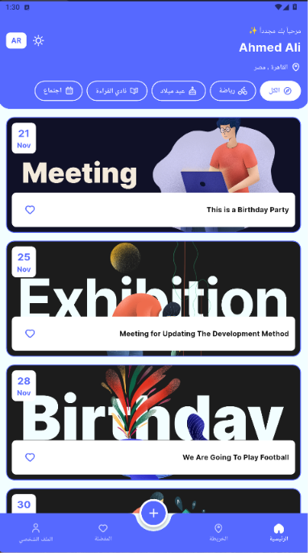<br>
        <strong>Home Dashboard — Light Theme</strong><br>
        <em>Soft `#F2FEFF` background with dynamic category pill filter bar</em>
      </td>
      <td align="center" width="50%">
        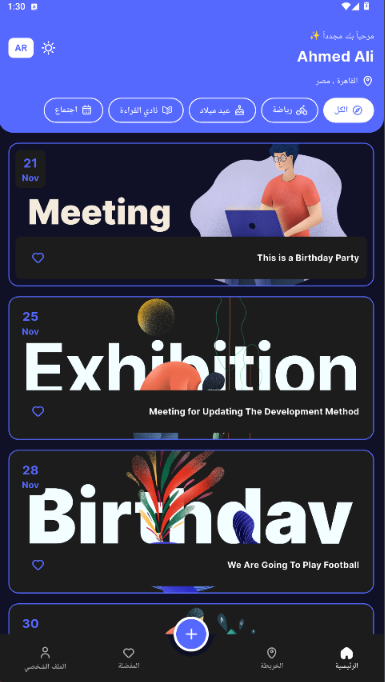<br>
        <strong>Home Dashboard — Dark Theme</strong><br>
        <em>Midnight `#101127` canvas with `#1C1C1C` high-contrast event cards</em>
      </td>
    </tr>
  </table>
</div>

---

### 3. Event Creation & Details Lifecycle
<div align="center">
  <table>
    <tr>
      <td align="center" width="50%">
        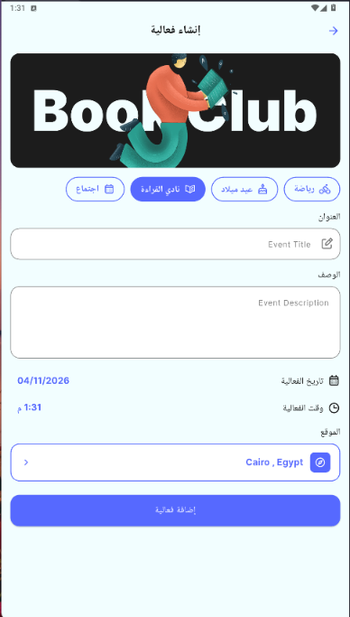<br>
        <strong>Create Event Screen</strong><br>
        <em>Category switcher updating header banner, date/time pickers & location</em>
      </td>
      <td align="center" width="50%">
        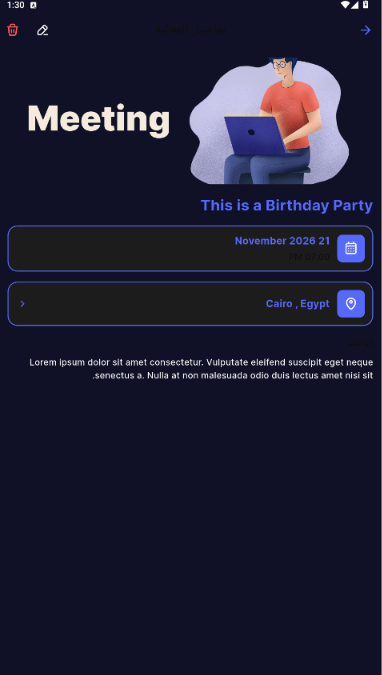<br>
        <strong>Event Details (Dark Theme)</strong><br>
        <em>Event banner, interactive date & location tiles, edit and delete actions</em>
      </td>
    </tr>
  </table>
</div>

---

### 4. Discovery, Map, Favorites & Profile
<div align="center">
  <table>
    <tr>
      <td align="center" width="33%">
        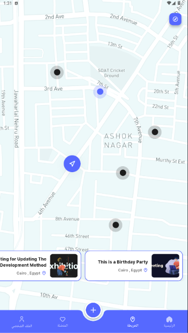<br>
        <strong>Map Tab</strong><br>
        <em>Figma-faithful map view with GPS button & horizontal event carousel</em>
      </td>
      <td align="center" width="33%">
        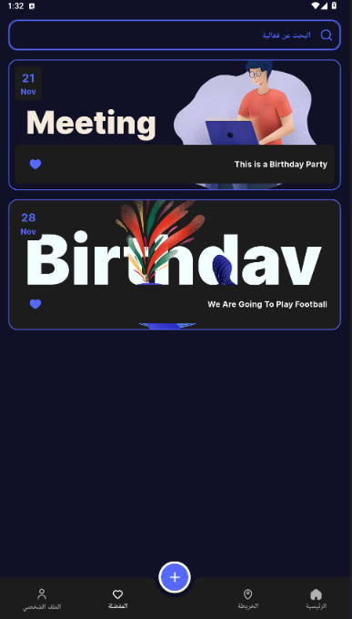<br>
        <strong>Favorites & Search</strong><br>
        <em>Real-time search bar filtering favorited events with filled heart badges</em>
      </td>
      <td align="center" width="33%">
        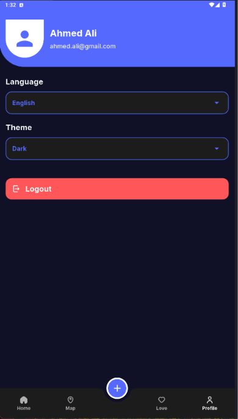<br>
        <strong>Profile Tab (English LTR)</strong><br>
        <em>User card, custom Theme and Language bottom sheets, and secure Logout</em>
      </td>
    </tr>
  </table>
</div>

---

## 🌟 Key Features & Capabilities

- 🌓 **Dynamic Dual Theming (`AppThemeProvider`):**
  - Seamless toggle between Light and Dark palettes across all screens and bottom sheets.
  - Custom surface colors matching Figma tokens (`#F2FEFF`, `#101127`, `#1C1C1C`).
  - Automatically persisted in `SharedPreferences` across app restarts.

- 🌐 **Comprehensive Dual Localization (`AppLanguageProvider`):**
  - Full English (`en`) and Arabic (`ar`) translation for all headers, fields, dialogs, and dynamic categories.
  - Bidirectional layout adaptation (`LTR` ⇄ `RTL`) with mirrored navigation and iconography.

- 🔐 **Authentication & Session Persistence (`AppAuthProvider`):**
  - Complete Login, Registration, and Forgot Password workflows with strict email regex and password rules.
  - Interactive Google Account Chooser modal (`GoogleSignInBottomSheet`) allowing selection of existing accounts or adding a custom account.
  - Active user session caching in local storage.

- 📅 **Full Event CRUD Lifecycle (`EventProvider`):**
  - **Create:** Real-time dynamic banner switching based on selected category (`Book Club`, `Meeting`, `Birthday`, `Sport`, `Exhibition`).
  - **Read:** Filterable event list by category on Home, plus dedicated Map and Favorites feeds.
  - **Update:** Pre-filled edit form preserving event timestamps and category tokens.
  - **Delete:** Contextual deletion with confirmation and automatic list refresh.

- 🗺️ **Figma-Faithful Map & Navigation:**
  - Curved notched bottom navigation bar with 4 tabs: **Home, Map, Favorites (Love), Profile**.
  - Prominent center Floating Action Button (`+`) routing directly to `CreateEventScreen`.
  - Map tab featuring interactive event cards carousel linking to full event details.

- ❤️ **Favorites & Live Search:**
  - One-tap favorite toggling with persistent state.
  - Instant live search bar filtering events by title.

---

## 🏗️ Architecture & Engineering Blueprint

The project strictly follows **Feature-First Clean Architecture**, isolating domain business logic from UI widgets and persistence frameworks.

### Project Folder Structure

```
lib/
├── main.dart                               # Entry point, MultiProvider & Localization setup
├── app.dart                                # MaterialApp configuration, routes & themes
│
├── core/                                   # Shared application-wide infrastructure
│   ├── constants/                          # Global constants & assets
│   ├── errors/                             # Failures and Exception models
│   ├── l10n/                               # AppLocalizations dictionary (EN & AR)
│   ├── providers/                          # Core State Providers (Theme & Language)
│   └── widgets/                            # Reusable UI widgets (CustomTextField, CustomButton)
│
├── utils/                                  # Mandatory Course Standard Utility Files
│   ├── app_color.dart                      # Official Figma hex color palette
│   ├── app_theme.dart                      # Light and Dark ThemeData definitions
│   ├── app_routes.dart                     # Named route constants and route map
│   ├── app_images.dart                     # Static asset paths (SVGs, PNGs, Banners)
│   └── app_style.dart                      # Typography system (Inter & Jockey One)
│
└── features/                               # Modular business features
    ├── auth/                               # Login, Register, Forgot Password, Google Sheet
    │   ├── data/                           # User models & local persistence repository
    │   ├── domain/                         # User entity & auth repository interface
    │   └── presentation/                   # Auth screens & AppAuthProvider
    ├── events/                             # Event creation, editing, details & listing
    │   ├── data/                           # EventModel & SharedPreferences storage
    │   ├── domain/                         # Event entity, EventCategory enum
    │   └── presentation/                   # Home, Create, Edit, Details screens & EventProvider
    ├── layout/                             # Notched Bottom Navigation & FAB
    │   └── presentation/                   # MainLayoutScreen & CustomBottomNavBar
    ├── map/                                # Map Tab with Carousel
    │   └── presentation/                   # MapTab & EventCarouselCard
    ├── favorites/                          # Bookmarked events & search
    │   └── presentation/                   # FavoritesTab & SearchBar
    └── profile/                            # User profile, settings & modal sheets
        └── presentation/                   # ProfileTab, LanguageBottomSheet, ThemeBottomSheet
```

### The 5 Standard Utility Modules (`lib/utils/`)

Per the lab specification, all core tokens reside exclusively in `lib/utils/`:
1. **`AppColor`**: Accurate Figma color definitions (`primary`, `backgroundLight`, `backgroundDark`, `cardDark`, `dangerRed`).
2. **`AppTheme`**: Complete `ThemeData.lightTheme` and `ThemeData.darkTheme` setups.
3. **`AppRoutes`**: Centralized route registry (`/splash`, `/onboarding`, `/login`, `/register`, `/home`, `/create-event`, `/event-details`).
4. **`AppImages`**: Central asset catalog linking icons, category banners, and illustrations.
5. **`AppStyle`**: Type scale using Google Fonts `Inter` (`bold24`, `bold20`, `bold16`, `medium16`, `regular14`) and `Jockey One` (`logo36`).

### State & Data Flow Diagram

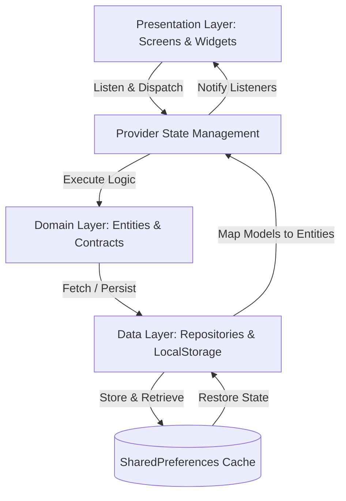

---

## 🎨 Design System & Tokens

Accurately extracted from the [Figma Specification](https://www.figma.com/design/uFT7VwlqWrlVin02qATxZ4/Event-Planning-App--Copy-?node-id=0-1):

| Token Name | Hex Code | Visual Sample | Application Role |
| :--- | :---: | :---: | :--- |
| **`primary`** | `#5669FF` |  | Brand primary, action buttons, active tab indicators |
| **`backgroundLight`** | `#F2FEFF` |  | Scaffold background in Light Mode |
| **`backgroundDark`** | `#101127` |  | Scaffold background in Dark Mode |
| **`cardDark`** | `#1C1C1C` |  | Dark theme card surfaces and bottom sheets |
| **`white`** | `#FFFFFF` |  | Light card surfaces, pure white highlights |
| **`textBaseDark`** | `#0F0F0F` |  | Primary headings and text in Light Mode |
| **`textSecondary`** | `#7B7B7B` |  | Subtitles, hints, and secondary descriptions |
| **`dangerRed`** | `#FF5659` |  | Delete event, logout button, error banners |

---

## 🧪 Quality Assurance & Test Suites

The codebase was constructed through strict **Test-Driven Development (TDD)**:

- 📊 **Total Test Count:** **101 automated tests**
- 🎯 **Pass Rate:** **100% (101/101 passing)**
- 🧹 **Code Analysis:** `flutter analyze` returns **`No issues found!`** (0 errors, 0 warnings, 0 lints).
- 📐 **Responsive & Accessibility Testing:** Verified on compact viewports (`360x640`) and elevated text scale (`1.25x`) with zero layout overflows.
- 🔄 **End-to-End User Journeys:** Validated full auth-to-event lifecycle integration flows.

### Running Test Suites:
```bash
# Run the complete test suite
flutter test

# Run code analysis
flutter analyze
```

---

## 📦 Tech Stack & Dependencies

All dependencies are aligned with course mandates without external third-party bloat:

| Package | Version | Purpose |
| :--- | :---: | :--- |
| **`provider`** | `^6.1.2` | Reactive state management (`ChangeNotifier`, `Consumer`) |
| **`shared_preferences`** | `^2.5.4` | Local caching for user sessions, events, theme, and language |
| **`google_fonts`** | `^6.2.1` | Figma typography (`Inter` & `Jockey One`) |
| **`flutter_svg`** | `^2.0.17` | High-fidelity vector rendering for icons and logos |
| **`flutter_localizations`** | `SDK` | Native English and Arabic language translation and RTL support |
| **`intl`** | `any` | Date, time, and currency formatting |
| **`equatable`** | `^2.0.7` | Value equality for entities and test assertions |

---

## 🚀 Quickstart & Installation

### Prerequisites
- [Flutter SDK](https://docs.flutter.dev/get-started/install) (version 3.24 or higher).
- Android Studio / VS Code with Flutter extensions.
- An Android Emulator (API 30+) or physical device connected via USB.

### Setup Instructions
```bash
# 1. Clone the repository
git clone https://github.com/your-username/evently.git

# 2. Navigate to the project root
cd evently

# 3. Install packages
flutter pub get

# 4. Run the application
flutter run
```

### Building the Release APK
```bash
flutter build apk --debug
# Output generated at: build/app/outputs/flutter-apk/app-debug.apk
```

---

## 👥 Course & License

- **Course:** Mobile Programming II — Practical Lab Project (NCT).
- **Design Credits:** [Figma Community: Event Planning App](https://www.figma.com/design/uFT7VwlqWrlVin02qATxZ4/Event-Planning-App--Copy-?node-id=0-1).
- **License:** Distributed under the [MIT License](LICENSE).

<p align="center">
  Crafted with precision, clean engineering, and passion 💙
</p>
